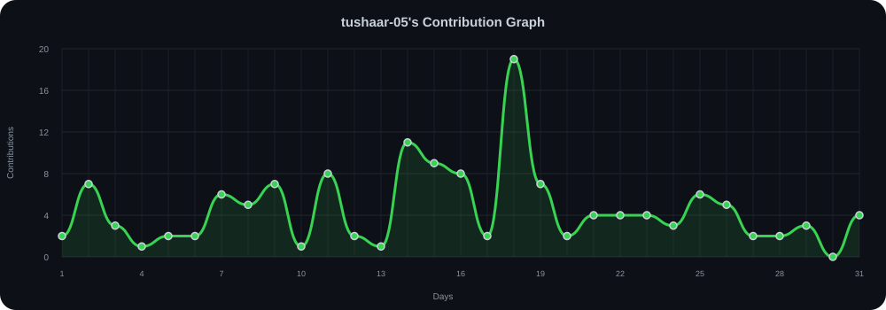

  

<h1 align="center">
  Hey there! I'm Tushar Singh
</h1>

<h3 align="center">
  FullStack Developer | Open Source Contributor | Sophomore
</h3>

  

---

## About Me  
- A **full stack developer** who loves building clean, modern websites and apps where design, functionality, and even the smallest details matter.
- Exploring AI-powered applications, scalable backend systems, and modern web architectures.
- 2nd year B.Tech student actively contributing to open-source communities.

---

## Featured Projects

| Project | Description | Tech Stack | Links |
| :--- | :--- | :--- | :--- |
| **Preper** | Full-stack exam and interview preparation platform featuring authentication, payments & mock assessments | `Python` `Flask` `SQLAlchemy` `MySQL` | [Live Demo](https://preper.co.in) • [GitHub](https://github.com/tushaar-05/Preper) |
| **Tekron NST '26** | Official platform for annual flagship tech fest Tekron NST with event schedules and registrations | `React` `JavaScript` `Tailwind` | [Live Demo](https://tekronfest.com/) • [GitHub](https://github.com/tushaar-05/tekron_NST26) |
| **Significo** | Modern web experience featuring fluid layouts, creative UI transitions, and smooth scroll animations | `Tailwind` `GSAP` `JavaScript` `HTML5` | [Live Demo](https://siignifico.netlify.app/) • [GitHub](https://github.com/tushaar-05/Significo) |
| **NST-SDC** | Student Development Club (SDC) website for community activities, initiatives, and resources | `React` `Vite` `JavaScript` `Tailwind` | [Live Demo](https://nst-sdc-coral.vercel.app) • [GitHub](https://github.com/tushaar-05/nst-sdc) |
| **Miles4Smiles** | Non-profit initiative web platform for social impact, charity 5k run event. | `TypeScript` `React` `Next.js` | [Live Demo](https://milesforsmiles-flame.vercel.app) • [GitHub](https://github.com/tushaar-05/Miles4Smiles) |
| **Smart Classroom Management** | Role-based system for managing classroom attendance, grading, equipment bookings & analytics | `Python` `SQLite` `CLI` | [GitHub](https://github.com/tushaar-05/Smart-Classroom-Management) |

---

<!-- OSS-TRACKER:START -->
## 🌐 Open Source Contributions

  
  
  
  
  

| Repository | Open | Review Status | Merged | Total | Lines Contributed |
| :--- | :---: | :---: | :---: | :---: | :---: |
| [**CircuitVerse/cv-frontend-vue**](https://github.com/CircuitVerse/cv-frontend-vue) | [15](https://github.com/CircuitVerse/cv-frontend-vue/pulls?q=is%3Apr+author%3Atushaar-05+is%3Aopen) | • 3 awaiting review • 5 changes requested • 7 approved | [1](https://github.com/CircuitVerse/cv-frontend-vue/pulls?q=is%3Apr+author%3Atushaar-05+is%3Amerged) | **16** | `+1,201 / -1,091` (2,292 total) |
| [**accordproject/concerto**](https://github.com/accordproject/concerto) | [2](https://github.com/accordproject/concerto/pulls?q=is%3Apr+author%3Atushaar-05+is%3Aopen) | • 2 awaiting review | [4](https://github.com/accordproject/concerto/pulls?q=is%3Apr+author%3Atushaar-05+is%3Amerged) | **6** | `+1,237 / -139` (1,376 total) |
| [**learningequality/kolibri**](https://github.com/learningequality/kolibri) | [1](https://github.com/learningequality/kolibri/pulls?q=is%3Apr+author%3Atushaar-05+is%3Aopen) | - | [2](https://github.com/learningequality/kolibri/pulls?q=is%3Apr+author%3Atushaar-05+is%3Amerged) | **3** | `+139 / -217` (356 total) |
| [**json-schema-org/JSON-Schema-Test-Suite**](https://github.com/json-schema-org/JSON-Schema-Test-Suite) | - | - | [2](https://github.com/json-schema-org/JSON-Schema-Test-Suite/pulls?q=is%3Apr+author%3Atushaar-05+is%3Amerged) | **2** | `+165 / -0` (165 total) |
| [**sugarlabs/musicblocks**](https://github.com/sugarlabs/musicblocks) | - | - | [2](https://github.com/sugarlabs/musicblocks/pulls?q=is%3Apr+author%3Atushaar-05+is%3Amerged) | **2** | `+51 / -16` (67 total) |
| [**nst-sdc/nst--events**](https://github.com/nst-sdc/nst--events) | - | - | [2](https://github.com/nst-sdc/nst--events/pulls?q=is%3Apr+author%3Atushaar-05+is%3Amerged) | **2** | `+0 / -0` (0 total) |
| [**oppia/oppia**](https://github.com/oppia/oppia) | [1](https://github.com/oppia/oppia/pulls?q=is%3Apr+author%3Atushaar-05+is%3Aopen) | • 1 changes requested | - | **1** | `+11 / -2` (13 total) |

<!-- OSS-TRACKER:END -->

---

## Tech Stack

### Languages & Frontend

  

### Backend & Databases

  

### DevOps, Cloud & Tools

  

## Currently Learning

  

---

## Contribution Graph

  

---

## GitHub Stats & Streak

  
  

---

  

---

## Connect With Me  

  
  
  
  
  

---

  

